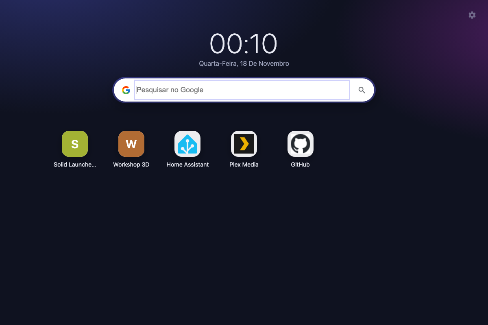

# 🚀 Super Launcher

A lightweight, elegant, and self-hosted personal dashboard and application launcher built with **Go (Golang)** and an embedded **SQLite** database (pure Go, CGO-free).



---

## ✨ Features

- **Google Search Integration**:
  - Prominently positioned search bar at the top of the homepage.
  - Search queries redirect straight to Google results (`https://www.google.com/search?q=...`).
  - Real-time digital clock and localized date display.

- **App Grid & Dashboard**:
  - Displays shortcuts to your self-hosted apps, home lab services, or web tools (e.g., Solid Voucher 3D, Workshop, Plex, Home Assistant).
  - Open links in the same tab or a new tab.

- **Automated Favicon & Logo Discovery**:
  - Automatically fetches high-resolution icons (Apple touch icons, HTML favicons, root favicon, and Google Favicons fallback) when entering an app's URL.
  - Supports manual image upload (PNG, SVG, JPG, WebP, ICO).
  - Elegant fallback letter avatar with consistent custom colors if no icon is available.

- **Live Health & Status Checks (Online / Offline)**:
  - Background asynchronous status checking for all registered services.
  - Offline apps are displayed with a grayscale, faded icon and disabled click events.
  - Automatically refreshes status periodically without reloading the page.

- **Admin Management Panel (`/admin`)**:
  - Password protected with secure HMAC-SHA256 session cookies.
  - **Create / Add**: Register new applications with name, URL, description, icon, and position ordering.
  - **Read / List**: View all registered applications and order sequence.
  - **Update / Edit**: Modify details, replace, or remove icons.
  - **Delete**: Remove apps with confirmation prompt and automatic cleanup of orphaned icon uploads on disk.

---

## 🚀 Getting Started

### Prerequisites

- Go 1.25+ (to build from source)

### Build and Run

```bash
# Build the binary
go build -o superlauncher .

# Run the server
./superlauncher
```

By default, the application runs on port `:9090`.

Access via your browser:
- **Homepage (Launcher)**: [http://localhost:9090](http://localhost:9090)
- **Admin Panel**: [http://localhost:9090/admin](http://localhost:9090/admin) *(default password: `admin`)*

---

## ⚙️ Configuration (Environment Variables)

Customize server options by setting environment variables:

| Variable | Default | Description |
| :--- | :--- | :--- |
| `ADDR` | `:9090` | Host and port to listen on (e.g., `:3000`, `0.0.0.0:9090`) |
| `DATA_DIR` | `data` | Directory where SQLite database and file uploads are stored |
| `ADMIN_PASSWORD` | `admin` | Password to access the `/admin` area |

### Example with custom settings:

```bash
ADMIN_PASSWORD="mysecretpassword" ADDR=":9090" ./superlauncher
```

---

## 📁 Project Structure

```text
superlauncher/
├── data/                  # Runtime SQLite database and uploaded icon assets
├── static/                # Static assets embedded into the binary via go:embed
│   ├── favicon.svg
│   └── style.css
├── templates/             # HTML templates embedded into the binary via go:embed
│   ├── form.html          # Create and Edit application form
│   ├── index.html         # Homepage launcher with search bar and app grid
│   ├── list.html          # Admin application listing
│   ├── login.html         # Admin authentication
│   └── partials.html      # Shared template partials
├── fetcher.go             # Automatic favicon/icon scraper and resolver
├── handlers.go            # HTTP routes, authentication, and upload handlers
├── main.go                # Application entry point and server setup
├── status.go              # Health check and status monitoring service
├── store.go               # SQLite database access layer (CRUD)
├── store_test.go          # Repository unit tests
├── go.mod                 # Go module definition
├── .gitignore             # Git ignore configuration
└── README.md              # Project documentation
```

---

## 🧪 Testing

Run tests with:

```bash
go test -v ./...
```
